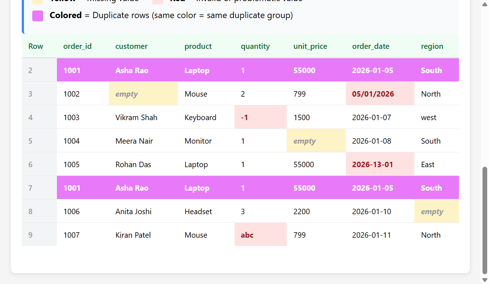
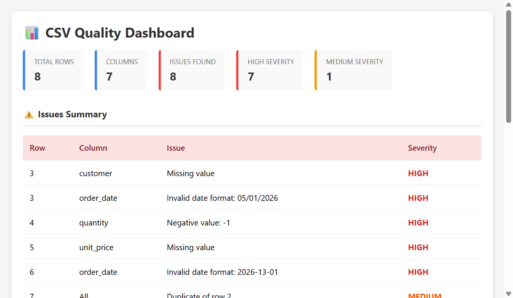

# 📊 CSV Quality Checker - Claude 

An intelligent CSV quality checking and validation system I made powered by Claude with effective use of skill and subagent. This tool automatically detects data quality issues and generates an interactive visual dashboard so that anyone can follow the visual dashboard to fix the data in CSV files at ease.
<br>


<br>
I have also included sales_messy.csv file in this repository, which is a very simple sample CSV file that can be used to test the skill and subagent for CSV data quality check and data cleaning:

## 📑 Table of Contents

- [✨ Features](#features)
- [⚙️ Usage](#usage)
- [📊 Dashboard Components](#dashboard-components)
- [Quality Checks in Detail](#quality-checks-in-detail)
- [📁 File Structure](#file-structure)
- [🎯 Why Skill + Subagent Architecture?](#why-skill--subagent-architecture)
- [Benefits of Subagent Integration](#benefits-of-subagent-integration)
- [Real-World Example](#real-world-example)
- [Integration with Subagents](#integration-with-subagents)
- [Example Output](#example-output)
- [Dashboard Screenshots & Visual Example](#dashboard-screenshots--visual-example)
- [Next Steps](#next-steps)

## Features

### 🔍 Comprehensive Quality Checks

The CSV Quality Checker validates your data against multiple criteria:

- **Missing Values** - Identifies empty cells in required columns
- **Duplicate Rows** - Detects and highlights identical row duplicates
- **Invalid Dates** - Validates dates are in YYYY-MM-DD format with correct month/day values
- **Negative Quantities/Prices** - Flags negative values in numeric columns
- **Invalid Data Types** - Detects non-numeric values in number-only columns

### 📊 Interactive HTML Dashboard


<br>
Generates a beautiful, interactive dashboard with:

1. **Summary Statistics**
   - Total row count and column count
   - Issue count breakdown by severity (High/Medium)

2. **Issues Summary Table**
   - Row number and affected column
   - Issue description
   - Severity level (HIGH/MEDIUM/LOW)

3. **Data Preview with Visual Highlights**
   - Complete CSV data displayed in an interactive table
   - **Yellow cells** = Missing values (empty cells)
   - **Red cells** = Invalid or problematic values (wrong format, negative numbers, invalid types)
   - **Colored rows** = Duplicate rows (same color indicates same duplicate group)
   - Color legend for easy reference

### 🤖 Subagent-Powered Workflow

The skill uses dedicated agents for:
- **csv-quality-agent** - For multi-step data analysis and cleanup operations
- **Automatic judgment** - Subagents are invoked automatically for file modification tasks without requiring manual approval

## Usage

### Basic Invocation

```bash
# Via Claude Code skill
/csv-quality-checker

# Or directly with Python
python .claude/skills/csv-quality-checker/csv_quality_checker.py <csv_file>
```

### Workflow

1. **Analyze** - The skill reads your CSV file and checks for all quality issues
2. **Report** - Issues are summarized in a text report with row numbers and severity levels
3. **Visualize** - An HTML dashboard is automatically generated showing:
   - Statistical summary cards
   - Detailed issues table
   - Complete data preview with visual highlights
4. **Publish** - Dashboard is published as an interactive Artifact for easy viewing

## Dashboard Components

### Statistics Panel

Shows at-a-glance metrics:
- **Total Rows** - Number of data rows (excluding header)
- **Columns** - Number of columns
- **Issues Found** - Total count of quality issues
- **High Severity** - Critical issues that must be fixed
- **Medium Severity** - Issues that should be reviewed

### Issues Summary Table

Detailed breakdown of each issue:
- Row number where issue occurs
- Column affected
- Issue description with specific values
- Severity classification

### Data Preview Table

The complete CSV data with intelligent highlighting:
- **Yellow highlighting** - Immediately spot missing data
- **Red highlighting** - Quickly identify invalid or problematic values
- **Color groups** - Duplicate rows are highlighted in matching colors, making it obvious which rows are duplicates
- Row numbers on the left for easy reference

### Legend

Clear color coding explanation:
- Yellow = Missing value
- Red = Invalid or problematic value  
- Colored rows = Duplicate rows (same color = same duplicate group)

## Output Format

The dashboard is generated as a self-contained HTML file with:
- Responsive design that works on all screen sizes
- Fully styled tables with hover effects
- Professional color scheme for easy scanning
- No external dependencies

## Quality Checks in Detail

### Missing Values
Any empty cell is flagged as HIGH severity. These represent incomplete data that may cause issues in downstream processing.

### Duplicate Rows
When two or more rows contain identical data, they are marked as MEDIUM severity. The dashboard visually groups duplicates using matching colors.

### Invalid Dates
Date columns must follow YYYY-MM-DD format:
- Wrong format (e.g., "05/01/2026" instead of "2026-05-01") = HIGH severity
- Invalid month values (e.g., "2026-13-01") = HIGH severity
- Invalid day values are also caught

### Negative Quantities/Prices
In columns named "quantity", "qty", "price", "unit_price", "cost", or "amount":
- Negative values are flagged as HIGH severity
- Non-numeric values (e.g., "abc" instead of a number) are flagged as HIGH severity

## File Structure

```
.claude/skills/csv-quality-checker/
├── SKILL.md                      # Skill definition and instructions
├── csv_quality_checker.py        # Main Python script for analysis
└── agents/
    └── csv-quality-agent.md      # Subagent definition for cleanup
```

## Why Skill + Subagent Architecture?

### The Problem with Skill-Only Approach

A skill alone provides instructions to Claude, but leaves execution in the main session:

- **Contaminated Context** - Intermediate file reads, validations, and errors fill up the conversation context
- **Complex Multi-Step Tasks** - Sequential operations (read → analyze → modify → validate) generate heavy output
- **Context Limits** - Large CSV files or many issues create verbose output that crowds the session
- **Manual Overhead** - User must ask each time to proceed to the next step
- **Inefficient Iteration** - Fixing multiple rows requires repeated context switching

### The Subagent Solution

A dedicated `csv-quality-agent` Subagent solves these problems:

```
Skill (Instruction Layer)
    ↓
CSV Quality Checker runs analysis
    ↓
[Decision Point]
    ├─ Simple case → Report here, keep in main session
    └─ Complex case → Spawn csv-quality-agent for cleanup
           ↓
        [Subagent handles multi-step work in isolation]
           ├─ Read original CSV
           ├─ Apply fixes
           ├─ Validate cleaned data
           ├─ Generate new CSV
           └─ Return only final results
```

### Benefits of Subagent Integration

#### 1. **Context Isolation** 🧠
- Heavy file I/O happens in the Subagent, not the main session
- Your conversation stays clean and focused
- No context waste on intermediate debugging steps

#### 2. **Auto-Judgment Execution** 🤖
With Subagent auto-judgment enabled:
```
User: "Fix the CSV file"
    ↓
[No manual approval needed]
    ↓
csv-quality-agent automatically spawned and executes
    ↓
"🤖 Subagent: csv-quality-agent - Data cleaning task"
```

#### 3. **Complex Multi-Step Operations** 📋
CSV cleanup is inherently multi-step:
- ✅ Read and parse the file
- ✅ Apply validation rules
- ✅ Make corrections (fill defaults, remove rows, fix formats)
- ✅ Validate cleaned data
- ✅ Write clean CSV
- ✅ Generate quality report

Subagents handle this elegantly without polluting the main conversation.

#### 4. **Parallel Processing** ⚡
If you have multiple CSVs:
```
csv_file_1.csv → csv-quality-agent (in background)
csv_file_2.csv → csv-quality-agent (in background)
csv_file_3.csv → csv-quality-agent (in background)

All process simultaneously while you work on something else
```

#### 5. **Better Error Handling** ⚠️
Subagents can:
- Retry failed operations automatically
- Handle edge cases without interrupting the main session
- Report only the final outcome, not every intermediate error
- Provide detailed logs if needed

#### 6. **Scalability** 📈
As your CSV files grow:
- **No context overload** - Subagent uses its own context budget
- **Handles large files** - No risk of exceeding main session limits
- **Memory efficient** - Each Subagent processes independently

#### 7. **Reusability & Consistency** 🔄
The Subagent approach means:
- Same cleaning rules apply consistently across all CSVs
- Can be scheduled or batched without manual intervention
- Results are predictable and reproducible

### Integration with Subagent Auto-Judgment

With the CLAUDE.md settings you configured:

```markdown
### Subagent Auto-Judgment
Use Subagents automatically when:
- Task involves multiple sequential steps
- File modifications or cleanup work
- Complex analysis requiring intermediate output
```

This means:
- ✅ No "Do you want me to fix this?" prompt needed
- ✅ Subagent automatically chosen if task requires it
- ✅ Results reported with transparency statement:

```
🤖 Subagent: csv-quality-agent
Reason: Multi-step file modification (read → validate → clean → write)
```

### Real-World Example

I have also included sales_messy.csv file in this repository, which is a very simple sample CSV file that can be used to test the skill and subagent for CSV data quality check and data cleaning:

**Without Subagent** (Skill-only):
```
You: "Fix the CSV"
Claude: "I'll read the file..." [verbose output]
Claude: "Found 8 issues..." [more output]
Claude: "Fixing row 1..." [more output]
Claude: "Fixing row 2..." [more output]
... [context gets crowded]
```

**With Subagent** (Current approach):
```
You: "Fix the CSV"
🤖 Subagent: csv-quality-agent
Reason: Multi-step file modification needed
[... processing happens in background ...]
✅ Fixed 8 issues
- Filled missing customer names
- Corrected date formats
- Removed duplicate rows
Output: sales_clean.csv
```

The Subagent approach keeps your main session focused while powerful work happens in the background.

## Integration with Subagents

This skill integrates seamlessly with Subagent workflows:

1. **Analysis Phase** - Runs in the main session for immediate feedback
2. **Cleanup Phase** - Can spawn csv-quality-agent for automated data fixes
3. **Transparency** - When Subagents are used, they're clearly announced:
   ```
   🤖 Subagent: csv-quality-agent
   Reason: Multi-step file modification (read → validate → clean → write)
   ```

## Example Output

When run on a messy CSV file, the dashboard displays:

- **Summary**: 8 data rows, 7 columns, 8 issues found (7 high, 1 medium)
- **Issues Listed**: 
  - Row 3: Missing customer name (HIGH)
  - Row 3: Invalid date format (HIGH)
  - Row 4: Negative quantity (HIGH)
  - Row 5: Missing unit price (HIGH)
  - Row 6: Invalid month in date (HIGH)
  - Row 7: Duplicate of row 2 (MEDIUM)
  - Row 8: Missing region (HIGH)
  - Row 9: Non-numeric quantity (HIGH)

- **Data Table**: All 8 rows visible with color-coded highlighting showing exactly where each issue is located

## Next Steps

After reviewing the quality dashboard, you can:

1. **Manually Fix** - Edit specific cells based on the highlighted issues
2. **Bulk Clean** - Use the csv-quality-agent for automated cleanup
3. **Delete Problematic Rows** - Remove rows that fail quality checks
4. **Fill Defaults** - Insert sensible default values for missing data

The dashboard makes it easy to decide which approach is best for your use case.

## Dashboard Screenshots & Visual Example

The generated dashboard displays issues with intelligent color highlighting:

### Dashboard Layout


```
┌─────────────────────────────────────────────────────────────┐
│ 📊 CSV Quality Dashboard                                    │
├─────────────────────────────────────────────────────────────┤
│                                                             │
│ Statistics Cards:                                           │
│ ┌──────────────┐ ┌──────────────┐ ┌──────────────┐        │
│ │ Total Rows   │ │   Columns    │ │ Issues Found │        │
│ │      8       │ │       7      │ │      8       │        │
│ └──────────────┘ └──────────────┘ └──────────────┘        │
│                                                             │
│ ┌──────────────┐ ┌──────────────┐                          │
│ │High Severity │ │Med. Severity │                          │
│ │      7       │ │      1       │                          │
│ └──────────────┘ └──────────────┘                          │
│                                                             │
├─────────────────────────────────────────────────────────────┤
│ ⚠️  Issues Summary                                          │
├─────────────────────────────────────────────────────────────┤
│ Row │ Column      │ Issue                      │ Severity  │
├─────┼─────────────┼────────────────────────────┼───────────┤
│  3  │ customer    │ Missing value              │ HIGH      │
│  3  │ order_date  │ Invalid format: 05/01/2026│ HIGH      │
│  4  │ quantity    │ Negative value: -1         │ HIGH      │
│  5  │ unit_price  │ Missing value              │ HIGH      │
│  6  │ order_date  │ Invalid month: 2026-13-01 │ HIGH      │
│  7  │ All         │ Duplicate of row 2         │ MEDIUM    │
│  8  │ region      │ Missing value              │ HIGH      │
│  9  │ quantity    │ Invalid value: abc         │ HIGH      │
├─────────────────────────────────────────────────────────────┤
│ 📋 Data Preview with Issues                                │
├─────────────────────────────────────────────────────────────┤
│                                                             │
│ Legend:                                                     │
│ 🟡 Yellow = Missing value                                  │
│ 🔴 Red = Invalid or problematic value                      │
│ 🟣 Colored = Duplicate rows (same color = same group)      │
│                                                             │
│ Row │ order_id │ customer    │ product    │ ...             │
├─────┼──────────┼─────────────┼────────────┼──              │
│  2  │ 1001     │ Asha Rao    │ Laptop     │ ... [PURPLE]   │
│  3  │ 1002     │[🟡 empty]   │ Mouse      │ ... [🔴 ERR]   │
│  4  │ 1003     │ Vikram Shah │ Keyboard   │ ... [🔴 ERR]   │
│  5  │ 1004     │ Meera Nair  │ Monitor    │ ... [🟡 empty] │
│  6  │ 1005     │ Rohan Das   │ Laptop     │ ... [🔴 ERR]   │
│  7  │ 1001     │ Asha Rao    │ Laptop     │ ... [PURPLE]   │
│  8  │ 1006     │ Anita Joshi │ Headset    │ ... [🟡 empty] │
│  9  │ 1007     │ Kiran Patel │ Mouse      │ ... [🔴 ERR]   │
│                                                             │
└─────────────────────────────────────────────────────────────┘
```

### Key Visual Features

1. **Color-Coded Cells**
   - Yellow highlighting immediately draws attention to missing data
   - Red highlighting shows invalid values or formatting errors
   - Matching colors on duplicate rows make it obvious which rows are identical

2. **Interactive Elements**
   - Hover effects on table rows for better readability
   - Responsive layout that adapts to different screen sizes
   - Clear section separations for easy navigation

3. **Professional Styling**
   - Green headers for data table to distinguish from issues table
   - Red headers for issues table to emphasize problems
   - Consistent color scheme throughout

## Live Dashboard

When you run the skill, a live interactive dashboard is generated and can be viewed in Claude Code's Artifact viewer. The dashboard includes:

- Fully clickable and scrollable tables
- Dynamic color highlighting based on issue type
- Professional typography and spacing
- Mobile-responsive design

## Integration Example

When using the Subagent for CSV cleanup:

```
🤖 Subagent: csv-quality-agent
Reason: Multi-step file modification and validation required
```

The agent will:
1. Read the original CSV file
2. Apply data cleaning rules
3. Generate the quality dashboard
4. Create a cleaned output file (if needed)
5. Report all changes made

---

**Version**: 1.0  
**Last Updated**: 2026-11-03  
